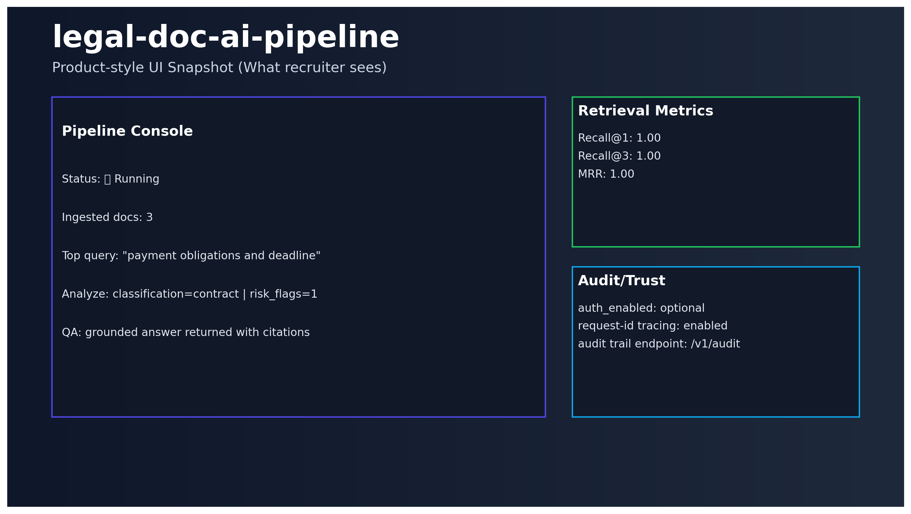

# ⚖️ legal-doc-ai-pipeline

[](https://github.com/keremercin/legal-doc-ai-pipeline/actions/workflows/ci.yml)


Production-oriented Legal Document AI pipeline with OCR, retrieval, analysis, and grounded Q&A.

## Why this project exists
Legal/ops teams spend too much time manually scanning files for obligations, payment terms, and risk signals.

This project turns that into an API-driven workflow:
- ingest legal documents,
- make them searchable,
- analyze them with structured outputs,
- answer questions with citations.

---

## Product view



---

## Core capabilities

- OCR/text extraction (`txt`, `pdf`, image)
- Rule/LLM classification
- Chunking + embeddings
- Hybrid retrieval (dense + lexical)
- Vector backend: `pgvector` or in-memory fallback
- Entity extraction + risk flags + summary
- Grounded Q&A (`/v1/qa`) with citations
- Optional API-key auth + audit trail (`/v1/audit`)

---

## API endpoints

- `GET /health`
- `POST /v1/ingest`
- `POST /v1/retrieve`
- `POST /v1/extract`
- `POST /v1/analyze`
- `POST /v1/qa`
- `GET /v1/audit`

Swagger: `http://localhost:8000/docs`

---

## Quickstart

```bash
cp .env.example .env
python -m venv .venv
source .venv/bin/activate
pip install -e .[dev]

docker compose up -d db
uvicorn legal_doc_ai.main:app --reload --host 0.0.0.0 --port 8000
```

Optional demo UI:
```bash
streamlit run streamlit_app.py
```

---

## Quality & reliability

- Automated tests + lint
- CI workflow (GitHub Actions)
- Benchmark script (`scripts/eval_retrieval.py`)
- Demo run report generator (`scripts/demo_walkthrough.py`)

---

## Measurable output

Current benchmark report includes:
- Recall@1
- Recall@3
- MRR

See: `reports/benchmark.md`

---

## Repository structure

```text
src/legal_doc_ai/
├─ api/
├─ core/
├─ services/
├─ db.py
├─ models.py
└─ main.py
```

---

## Documentation

- Architecture: `docs/ARCHITECTURE.md`
- Deployment: `docs/DEPLOYMENT.md`
- Render deploy: `docs/DEPLOY_RENDER.md`
- Case study: `docs/CASE_STUDY.md`
- Release notes: `docs/RELEASE_NOTES_v0.4.0.md`

---

## Hiring signal

This repo demonstrates end-to-end execution:
**problem framing → backend architecture → measurable evaluation → deploy-ready delivery.**
