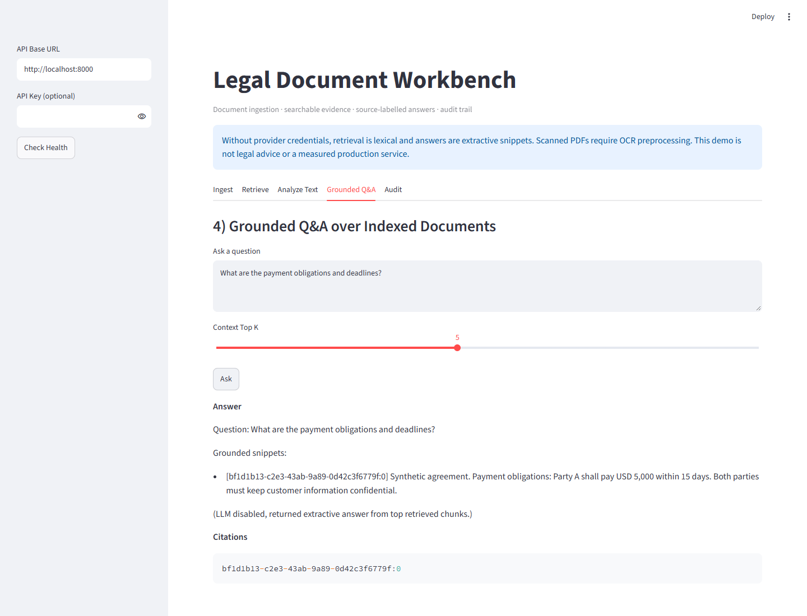
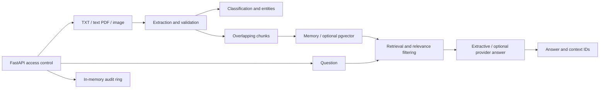

# Legal Document Workbench

[](https://github.com/keremercin/legal-doc-ai-pipeline/actions/workflows/ci.yml)

A Python/FastAPI reference implementation for turning documents into searchable text, structured extraction and source-labelled answers.



## Implemented behavior

- UTF-8 text, text-layer PDF and image OCR ingestion; unsupported or empty extraction is rejected before indexing.
- Chunking, rule-based classification, regex entity extraction and heuristic risk flags.
- In-memory storage for local demonstrations; optional PostgreSQL/pgvector backend.
- Retrieval, extractive Q&A, optional provider-generated answers, API-key access control and an in-memory audit trail.
- Relevant nonempty hits only for Q&A. Offline citations correspond to the snippets actually displayed.

## Two distinct modes

| Mode | Retrieval | Answers | Requirements |
| --- | --- | --- | --- |
| Local | Lexical overlap; deterministic placeholder vectors are not semantic embeddings | Extractive source snippets | No AI credentials; memory backend |
| Provider-enabled | Provider embeddings plus lexical score | Provider-generated response | Credentials, connectivity and separate live evaluation |

A positive retrieval score is not proof that a chunk answers a question. Provider-mode citation IDs identify supplied context; individual claims are not independently verified. This project does not claim production legal accuracy.

## Run locally

```bash
python -m venv .venv
# Linux/macOS: source .venv/bin/activate
# PowerShell: .venv\Scripts\Activate.ps1
python -m pip install -e ".[dev]"
```

Use `RETRIEVER_BACKEND=memory`, `CLASSIFIER_MODE=rule` and an empty `OPENAI_API_KEY` for the local path. Environment values override `.env` settings. Set `API_KEY` when restricting local API access.

```bash
python -m uvicorn legal_doc_ai.main:app --host 127.0.0.1 --port 8000
# In a second terminal:
python -m streamlit run streamlit_app.py
```

Open API docs at http://localhost:8000/docs. The UI includes ingestion, retrieval, analysis, Q&A and audit tabs. Its retrieval/Q&A handlers unwrap the API response envelope. The updated Q&A tab was exercised in Chromium against a running local API with synthetic input; the screenshot shows its actual source-labelled answer. API ingestion and an unrelated query were also exercised; unrelated terms returned no context and no citations. This is a local smoke check, not complete browser coverage or live provider validation.

## Architecture



## API and examples

`POST /v1/ingest`, `/v1/retrieve`, `/v1/extract`, `/v1/analyze`, `/v1/qa`; `GET /health`, `/version`, `/v1/audit`.

Responses use `{status, data, meta, error}`. Protected routes accept `X-API-Key` when configured. An unsupported upload returns HTTP 422 with `error.message`. Empty uploads return HTTP 400. Files with no extracted content never become searchable diagnostic strings.

For a synthetic text such as `Party A shall pay USD 5,000 within 15 days`, a payment query can return source snippets and chunk IDs. This illustrates extraction, not a client engagement or validated legal interpretation.

## Verification and evaluation

```bash
python -m pytest -q
python scripts/eval_retrieval.py
```

Latest local unit/API run: **28 tests passed**, with AI credentials disabled and the memory/rule configuration. Coverage includes extraction rejection before storage, source selection, invalid QA input, mocked provider-label validation and provider-failure fallback, authentication, API envelopes and a memory-mode health check that does not require PostgreSQL.

The existing retrieval benchmark is a small synthetic fixture set (10 queries over five short texts), not a held-out real-document benchmark. Its score does not establish OCR quality, semantic retrieval quality, answer correctness or live provider reliability. A separate `scripts/eval_grounding.py` diagnostic adds direct matches, paraphrases, unrelated questions and an overlapping hard negative. The recorded result in `reports/grounding-diagnostic.json` is **7/12 cases passed**: all four paraphrases were missed and the encryption-algorithm question retrieved a privacy snippet that cannot answer it. These failures expose the lexical baseline's limits; they are not hidden or converted into claims of semantic accuracy. The five-document diagnostic is manually authored and still not a held-out real-document benchmark.

## Limits

- Scanned PDFs need OCR preprocessing; image OCR requires a separately installed Tesseract executable.
- The memory store and audit ring are not durable across restarts.
- Provider outputs can contain unsupported claims. Citation presence is not claim verification.
- PostgreSQL/provider integration and OCR quality have not been exercised in the current local test pass.
- Regex entities and risk flags are heuristics, not a legal review system.
- Upload/resource limits and production deployment operations need further hardening.

Existing deployment notes and historical benchmark artifacts describe earlier configurations; validate against current code before using them for hosted operation.
