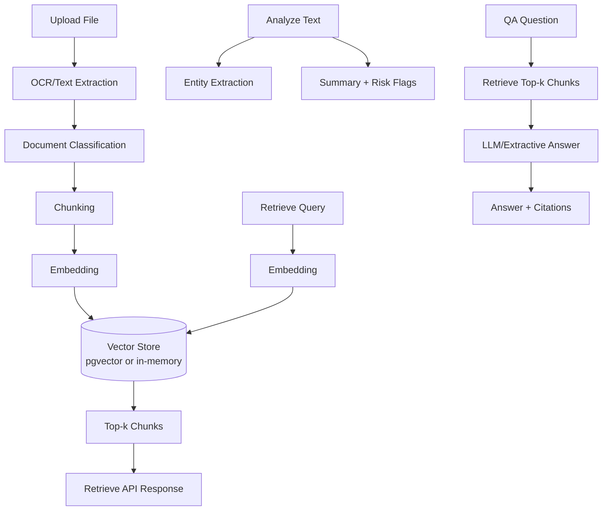

# Architecture

## Key modules

- `services/ocr.py` → parse txt/pdf/image
- `services/classifier.py` → rule/LLM classification
- `services/chunker.py` → chunk split policy
- `services/embeddings.py` → OpenAI/local vector generation
- `services/vector_store.py` → storage + retrieval abstraction
- `services/analyzer.py` → summary + risk flags
- `services/qa.py` → grounded question answering
- `api/routes.py` → ingest/retrieve/extract/analyze/qa endpoints
